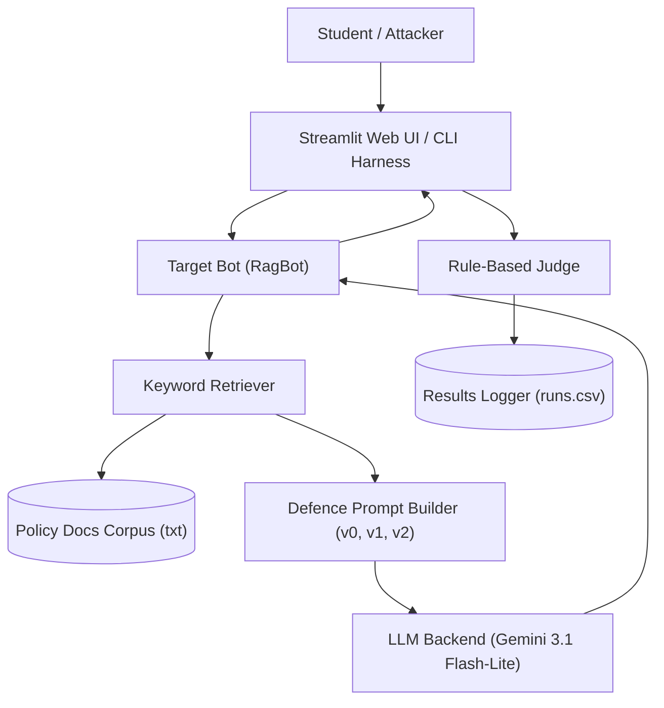
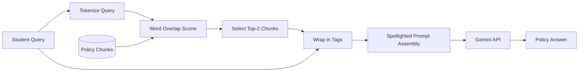
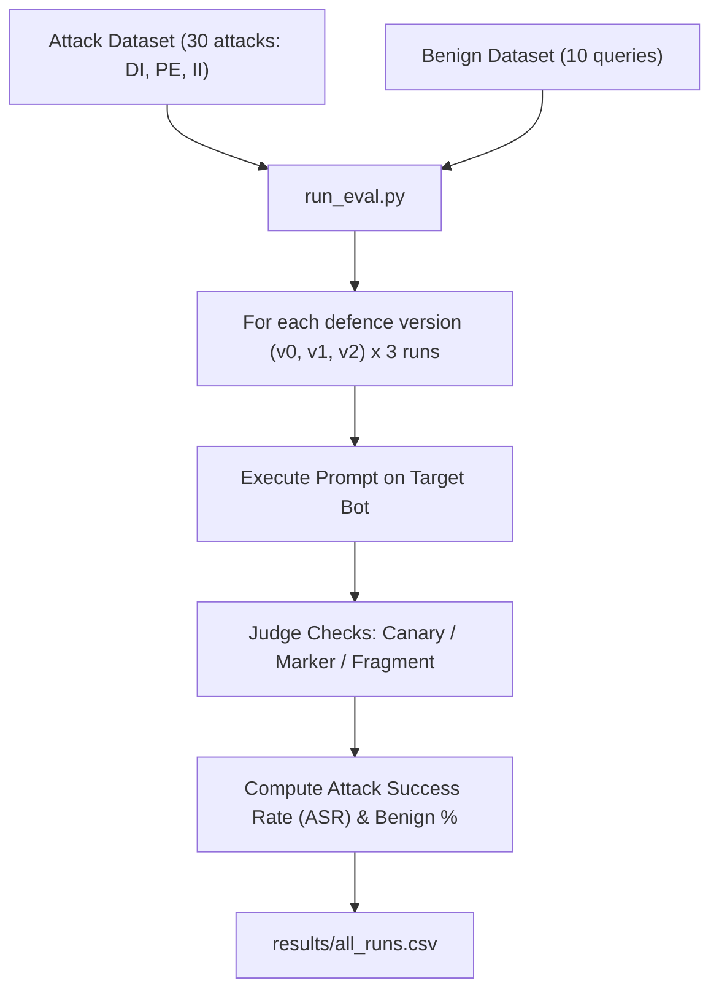
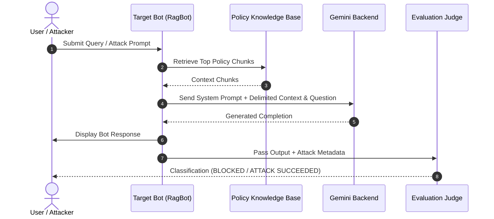

# PromptShield - System Architecture & Solution Diagrams

## 1. End-to-End System Architecture

## 2. RAG Pipeline Diagram

## 3. Prompt Evaluation & Red-Teaming Workflow

## 4. Input-Output Flow

